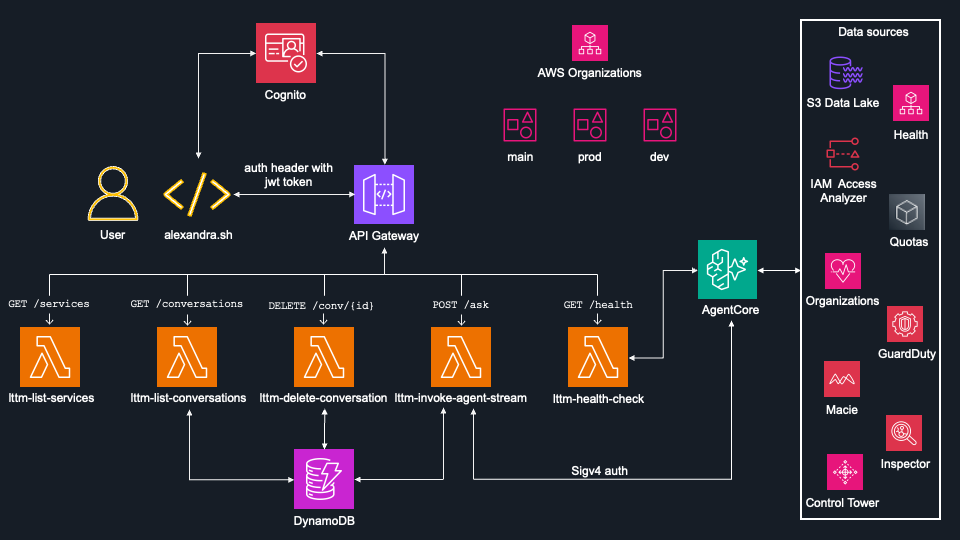
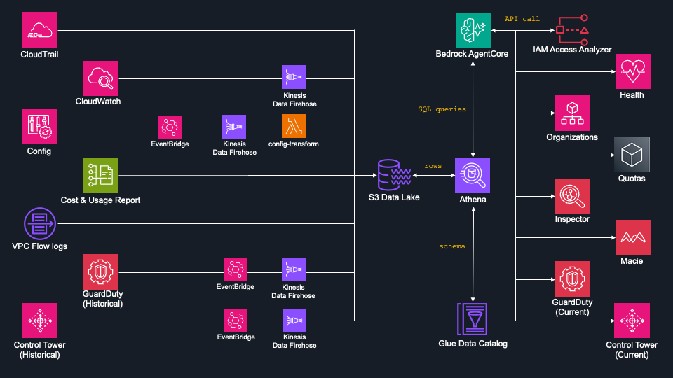
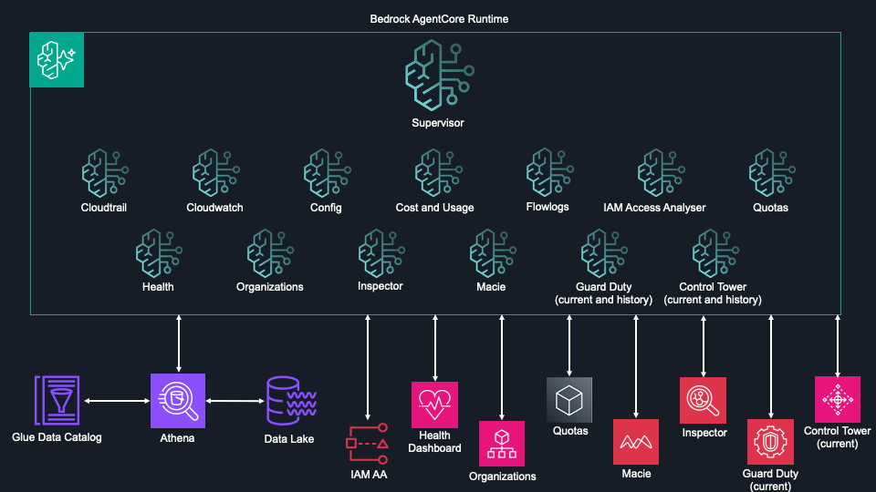
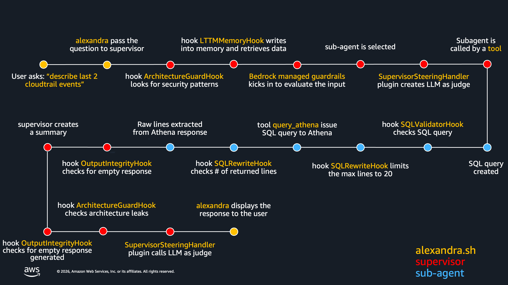

<!-- Copyright (c) 2025-2026 Michal Salanci -->
<!-- SPDX-License-Identifier: MIT -->

# Cloud Intelligence Agency (Logs talk to me v3)

**Cloud Intelligence Agency (Logs talk to me v3)** is a conversational interface for AWS infrastructure investigations.

You don't have to write Athena SQL, click through several AWS consoles, or stitch `aws cli` commands together across accounts. You ask a question in plain English, and the system gathers the evidence from logs, APIs and security services.

```bash
./alexandra.sh "show me the failed console logins in each account this week"
./alexandra.sh "what changed on security group sg-0a1b2c3d yesterday and who changed it?"
./alexandra.sh "how much did Bedrock cost in September, per account?"
./alexandra.sh "show the GuardDuty findings in all three accounts"
./alexandra.sh "which SCPs apply to the dev account?"
```



This is the **v3** release, a full rewrite. It uses:
- **Amazon Bedrock AgentCore** (Runtime, Memory, Evaluations) and **Strands Agents**;
- **Amazon Athena**, the **AWS Glue Data Catalog** and **Amazon S3**;
- **API Gateway**, **Cognito** and **DynamoDB**;
- a multi-account AWS log data lake.

> Earlier versions live on older branches of the original repository and are documented there:
> - [v1](https://github.com/msalanci/logs_talk_to_me/tree/v1) used **Amazon Lex** and a **single Lambda function**.
> - [v2](https://github.com/msalanci/logs_talk_to_me/tree/v2) used **API Gateway** with **three Lambda functions**.
> - v3 (this version) uses a supervisor/sub-agent architecture running in **Bedrock AgentCore Runtime**, utilizing **Bedrock AgentCore memory**.
## Contents

- [What LTTM can answer](#what-lttm-can-answer)
- [Account model](#account-model)
- [Architecture overview](#architecture-overview)
- [Why multiple agents?](#why-multiple-agents)
- [Models](#models)
- [Safety and anti-hallucination layers](#safety-and-anti-hallucination-layers)
- [Memory](#memory)
- [Streaming CLI](#streaming-cli)
- [CLI flags](#cli-flags)
- [Repository layout](#repository-layout)
- [Glue tables](#glue-tables)
- [Costs](#costs)
- [Known limitations](#known-limitations)
- [Important files](#important-files)
- [Prerequisites](#prerequisites)
- [Development notes](#development-notes)
- [Configuration checklist](#configuration-checklist)
- [Deployment order](#deployment-order)
- [Redeploying after a change](#redeploying-after-a-change)
- [Troubleshooting](#troubleshooting)
- [Usage examples](#usage-examples)
- [License](#license)

## What LTTM can answer

LTTM has one **supervisor agent** and **thirteen** specialized sub-agents, all on Claude Opus 4.6. The supervisor decides which sub-agent, or combination of sub-agents, each question needs.

| Domain          | Data source                    | Good for                                                                                                     |
| --------------- | ------------------------------ | ------------------------------------------------------------------------------------------------------------ |
| CloudTrail      | Athena over S3 data lake       | Who did what, API calls, IAM activity, read-only vs write events, sign-ins (console, IAM Identity Center, WorkMail) |
| CloudWatch      | Athena over S3 data lake       | Lambda/application logs, log group errors, DNS queries to your Route 53 hosted zones                         |
| Config          | Athena over S3 data lake       | Resource changes, configuration history, the daily resource inventory                                        |
| CUR             | Athena over S3 data lake       | Cost, spend trends, expensive services and resources                                                         |
| VPC Flow Logs   | Athena over S3 data lake       | Network traffic, rejected packets, source and destination IPs                                                |
| GuardDuty       | API + Athena archive           | Current findings, and findings history with sample (test) findings counted apart                             |
| Macie           | API                            | Sensitive data findings in S3 (PII, credentials)                                                             |
| Inspector       | API                            | Vulnerabilities, CVEs, EC2/Lambda/ECR findings                                                               |
| Access Analyzer | API (one organization analyzer) | Public or outside-the-organization access: who can get in, with which actions                               |
| Health          | API                            | AWS Health events, outages, scheduled maintenance (needs a Business or Enterprise Support plan)              |
| Organizations   | API                            | Accounts, OUs, the root, SCPs in effect (inherited ones included)                                            |
| Service Quotas  | API                            | Service limits and quota values                                                                              |
| Control Tower   | API + CloudTrail               | Landing zone state, enabled controls, baselines, operations, current drift, and what Control Tower did and who started it |

The supervisor can call several sub-agents for one question. For example:

```text
Who created the most expensive resources last month?
```

uses:

```text
CUR        → find expensive services/resources
CloudTrail → find who created or modified them
```

**Which accounts a question covers.** When a question names no account:

| Sub-agent                                                    | Default                  |
| ------------------------------------------------------------ | ------------------------ |
| CloudTrail, CloudWatch, Config, Flow Logs, Macie, Inspector  | the main account         |
| GuardDuty, Access Analyzer, Health, Service Quotas, CUR      | all three accounts       |
| Control Tower                                                | the whole landing zone   |

A question about several accounts goes to each sub-agent in **one call** that names them all. The sub-agent queries every account in that call, and its rows and totals say which account they belong to.

## Account model

LTTM runs across **three AWS accounts in one AWS Organization**: main, dev and prod.

- **Main** is the management account. It holds:
  - the data lake, Athena and Glue;
  - the API Gateway, the Lambdas, Cognito and DynamoDB;
  - the AgentCore runtime's IAM role.
- **Dev** and **prod** are member accounts. Their CloudTrail events (through the organization trail) and their Firehose-delivered logs land in the main account's data lake.
- **Account-local services in dev and prod** are read by assuming a per-service read role that Terraform creates in each member account: `LTTMHealthReadRole`, `LTTMQuotasReadRole`, `LTTMGuardDutyReadRole`, `LTTMMacieReadRole` and `LTTMInspectorReadRole`.
- **Access Analyzer** uses one **organization analyzer** in the main account (in eu-central-1, us-east-1 and us-west-2). It needs no role in dev or prod, and access between the three accounts is never reported as a finding.
- **Organizations** and **Control Tower** are read directly in the management account, with no role assumption.

**Control Tower is not required.** LTTM does not create or change a landing zone; it only reads one:
- If your organization has a landing zone, the Control Tower sub-agent answers about it.
- If it has none, the sub-agent says so.
- One catch: Terraform creates its own AWS Config recorder (named `default`) in the dev and prod home region. A region can hold only one recorder, so remove any other recorder there first (Control Tower's, for example).

## Architecture overview

```text
User / alexandra.sh
        ↓ Cognito JWT
API Gateway REST API (eu-central-1)
        ↓
Node.js 24 stream Lambda ("the shim": checks the request, keeps the conversation list)
        ↓ SigV4 InvokeAgentRuntime
Amazon Bedrock AgentCore Runtime (us-west-2; platform V2 from step 11)
        ↓ Bedrock guardrail check on the question
Supervisor agent
        ↓ one tool call per sub-agent
Sub-agents
        ↓
Athena / AWS APIs / AgentCore Memory
        ↓
Server-Sent Events streamed back to the CLI
```

There are two main data paths.

### 1. Historical log data path

Historical data is stored in an S3 data lake and queried with Athena.

```text
AWS services / accounts
        ↓
CloudTrail organization trail / CloudWatch Logs subscription policies → Firehose /
Config → EventBridge → Firehose / GuardDuty → EventBridge → Firehose /
VPC Flow Logs (Parquet) / CUR 2.0 export
        ↓
S3 data lake (eu-central-1)
        ↓
AWS Glue Data Catalog tables (partition projection)
        ↓
Amazon Athena (a 10 GiB cap per query)
        ↓
Athena-based sub-agents
```

Athena-based sub-agents:

```text
CloudTrail, CloudWatch, Config, CUR, Flow Logs, GuardDuty archive, Control Tower history (from CloudTrail)
```

What keeps the lake complete:
- **Firehose streams** write one JSON record per line (`AppendDelimiterToRecord`), so Athena sees every record.
- **GuardDuty findings from us-west-2** are forwarded to eu-central-1 by an EventBridge rule, so they are archived too.
- **AWS Config delivers a snapshot of every delivery channel** once a day, at 00:01 UTC, through EventBridge Scheduler. It is filed under the day before.
- **The Config Lambdas** write every capture and creation time in one UTC format.
- **The `lttm-flowlog-enforcer` Lambda** adds a VPC flow log to every new VPC: every 15 minutes in every account and region of the flow log table, and at once on a `CreateVpc` in the main account's project region.
- **The `lttm-lake-check` Lambda** runs Athena checks on the day before, every day at 02:30 UTC. It checks the Config times, account IDs, duplicates and snapshot deliveries, and emails you only when something is wrong.
- **An SNS email** goes out when any file lands in a Firehose error folder of the lake.

### 2. Current-state API path

For services where the current state matters more than long-term history, the agents call AWS APIs directly. Cross-account reads use STS `AssumeRole` into the read roles listed under [Account model](#account-model).

```text
Sub-agent
        ↓ boto3 API wrapper (every region the service runs in, by default)
AWS API (+ STS AssumeRole for dev and prod)
        ↓
Formatted raw result, with count lines and notes written by code
        ↓
Supervisor summary
```

API-based sub-agents:

```text
Access Analyzer, Health, Organizations, Quotas, Macie, Inspector, GuardDuty current findings, Control Tower
```



## Why multiple agents?

This project uses a **sub-agent-as-tool** pattern.

The supervisor agent does not hold every schema, every API reference and every service rule in one giant prompt. Instead, each sub-agent owns one domain.

```text
Supervisor
├── query_cloudtrail
├── query_cloudwatch
├── query_config
├── query_cur
├── query_flowlogs
├── query_guardduty
├── query_macie
├── query_inspector
├── query_access_analyzer
├── query_health
├── query_organizations
├── query_quotas
└── query_controltower
```

Benefits:

- smaller prompts per agent
- easier debugging
- easier service expansion
- better SQL/tool quality
- a different model per role if needed
- the supervisor can combine several sources into one answer

How a sub-agent call works:
- **A fresh sub-agent per call.** Each `query_*` tool builds a new sub-agent with new hooks, so nothing leaks from an earlier question, and two calls to the same sub-agent can run in parallel.
- **The input is written by code** (`utils/delegation.py`). It holds the user's question word for word, then the supervisor's request (subject, filters, accounts, time range, also from earlier turns), then the account names. The supervisor does not write SQL for the sub-agent; the sub-agent's own rules decide how to query.
- **The output is raw.** The sub-agent returns the raw tool results of the current question (`raw_results`), not its own summary. The supervisor is the only summarizer.



## Models

LTTM uses two Anthropic models on Amazon Bedrock, through US cross-region inference profiles (`us.`) called from `us-west-2`:

| Role                                    | Constant           | Model                | What it does                                                      |
| --------------------------------------- | ------------------ | -------------------- | ----------------------------------------------------------------- |
| Supervisor                              | `SUPERVISOR_MODEL` | **Claude Opus 4.6**  | Routes the question, calls sub-agents, writes the answer          |
| 13 sub-agents                           | `SUBAGENT_MODEL`   | **Claude Opus 4.6**  | Write the SQL or the API calls for their service                  |
| LLM judges (routing + output integrity) | `JUDGE_MODEL`      | **Claude Haiku 4.5** | `SupervisorSteeringHandler`; they only log (see the next section) |

The model IDs live in two places, one for calling the model and one for being allowed to:
- **`agents/utils/agent_vars.py`:** the role constants decide which model each agent calls.
- **`agent_models` in Terraform** (`terraform/terraform.tfvars`, or the default in `terraform/variables.tf`): the agent role may call only these. For each inference profile ID, Terraform builds both ARNs the role needs: the profile's, and its foundation model's in every Region.

To change a role's model:
1. Edit its constant in `agent_vars.py`.
2. Put the same inference profile ID in `agent_models`, and take out a model no agent calls any more.
3. Run `terraform apply`, then redeploy the agent ([Redeploying after a change](#redeploying-after-a-change)).

A model in only one of the two places fails at run time with `AccessDeniedException`.

Why Opus 4.6:
- Claude Sonnet 4, which this README used to name, reached its end of life on 2026-10-14.
- Newer models can be enabled in the model catalog and still refuse every call with `AccessDeniedException`. That happens when the account's *cross-region model inference tokens per minute* quota for the model is 0. Check that quota in Service Quotas before you switch.

Other model settings:
- **Prompt caching** with a 1-hour lifetime (`CACHE_TTL = "1h"`) on the supervisor and on the CloudTrail, CloudWatch and GuardDuty sub-agents. A question with a warm cache costs about half as much.
- **The supervisor's read timeout is 600 s**, because Strands' default of 120 s cut slow model calls.
- **No `CountTokens` call before each model call** (`use_native_token_count=False`).
- **Every model runs at temperature 1.** The same question can be worded, or routed, a little differently on each run.

## Safety and anti-hallucination layers

LTTM does not rely on a system prompt alone. The rule is:

> Agents may generate text, but deterministic checks decide what can execute, and code, not the model, computes the numbers.

**Before the agent runs**

| Layer                       | What it does                                                                                     |
| --------------------------- | ------------------------------------------------------------------------------------------------ |
| Cognito + API Gateway       | Authenticated public entry point                                                                 |
| Stream Lambda checks        | Refuses with HTTP 400 a body that is not a JSON object, an empty prompt, or a session ID that is not a lower-case UUID. Conversation titles are cleaned of control characters. |
| Bedrock guardrail           | `ApplyGuardrail` on the user's question (prompt attacks + off-topic). A refused question never reaches the agent. |
| Probe answer                | A question about the agent's own internals ("list your tools") gets a fixed answer without running the agent |

**While the sub-agents query**

| Layer                       | What it does                                                                                     |
| --------------------------- | ------------------------------------------------------------------------------------------------ |
| IAM roles                   | Least privilege. The agent role can read the lake, and write only `athena-results/`. Of the identities in dev and prod, only the Firehose delivery roles can write into the lake. |
| Lake Formation              | Table-level access to the Athena data                                                            |
| Athena workgroup cap        | A query that would scan more than 10 GiB is cancelled, and the agent narrows it and retries      |
| `SQLValidatorHook`          | Checks the SQL before Athena runs it:<br>• one `SELECT`/`WITH` statement only, checked with literals and comments blanked out;<br>• every partition key of every table filtered in that table's own `WHERE` (JOINs, subqueries, CTEs and UNIONs included);<br>• no `OR` at the top level of a `WHERE`;<br>• CloudTrail queries cover every region in use;<br>• LTTM's own runtime log groups are refused. |
| `SQLRewriteHook`            | Changes the query's own `LIMIT` and blocks repeats:<br>• a list gets `LIMIT 21`, so the answer can say "more than 20";<br>• a `GROUP BY` gets `LIMIT 101` (up to 100 groups);<br>• the same query twice in one question is blocked;<br>• each CloudTrail row gets its source file, for provenance. |
| Untrusted text              | Line breaks inside log values are escaped, so a log line cannot forge extra rows                 |
| CloudTrail provenance       | Each row of a row-level CloudTrail answer is labelled by code against CloudTrail's digest files: `SIGNED`, `NO DIGEST`, `PENDING`, `UNVERIFIED` or `MISMATCH` |
| Numbers written by code     | Code, not the model, computes:<br>• finding counts by severity, and totals over regions and accounts;<br>• money amounts in exact cents, with totals;<br>• the "Results: more than 20 rows" line. |
| Notes written by code       | An empty result carries one line that says what was searched and what the data covers (for example "VPC flow logs are not collected in us-west-2 (dev)") instead of a guessed cause |

**After the answer is written**

| Layer                       | What it does                                                                                     |
| --------------------------- | ------------------------------------------------------------------------------------------------ |
| `OutputIntegrityHook`       | Catches "no results" contradictions and follow-up detours                                        |
| `ArchitectureGuardHook`     | Redacts internal names in answers as `[internal]`                                                |
| `SupervisorSteeringHandler`: checks in code (they act) | Each one sends the model **one** correction made by code:<br>• **routing table:** a DNS question sent to Flow Logs is pointed to CloudWatch;<br>• **money check:** an answer that states an amount no cost result holds;<br>• **answer check:** an answer that claims "no drift" for controls Control Tower does not check, adds a cause to an empty result, or invents why an event happened. |
| `SupervisorSteeringHandler`: LLM judges (they only log) | Claude Haiku 4.5 judges routing before each tool call, and checks the final answer against the tool results. They run in **shadow mode**: they log `SHADOW GUIDE …` and never block a call or rewrite an answer. |
| Raw result extraction       | Sub-agents return raw tool results; the supervisor is the only summarizer                        |
| Online evaluation           | AgentCore Evaluations scores 10% of the questions (`evaluation_sampling_percentage`; Helpfulness, Correctness, Faithfulness, GoalSuccessRate, ToolSelectionAccuracy). It measures quality over time, and never changes an answer. |



## Memory

LTTM uses **AgentCore Memory**, so follow-up questions can use earlier context.

| Kind                        | What it stores                                                         | Namespace                            | Shared across sessions |
| --------------------------- | ---------------------------------------------------------------------- | ------------------------------------ | ---------------------- |
| Short-term (events)         | Every question and answer, kept for 7 days (`memory_retention_days`)   | per session                          | no                     |
| Semantic                    | Reusable facts                                                         | `default`                            | yes                    |
| Summarization               | A running summary of each session                                      | `{sessionId}`                        | no                     |
| Episodic: episodes          | What happened in one task, written when AgentCore decides the task is finished | per actor and session        | no                     |
| Episodic: reflections       | Lessons drawn from many episodes                                       | per actor                            | yes                    |

A custom `LTTMMemoryHook` saves the events and reads memory back:
- **On the first question of a session** (in each runtime process), it retrieves the 5 most relevant facts and the 3 most relevant reflections, and adds them to the supervisor's prompt for that question and the session's later ones. They go after the prompt-cache point, so they don't break the cache.
- **When AgentCore has stopped a session's process** (15 minutes idle), the next question reloads the last 10 messages and up to 3 topics of the session's summary.

Memory is treated as **context, not authority**: it helps with follow-ups, and should not silently change SQL filters or routing. It can still widen a question now and then ("also include the successful ones for comparison"). For exact answers or a demo, use `--clean`.

How to control it:
- **`--clean`** skips what memory adds (facts, reflections, the summary) for one question. The session's own conversation history still comes back.
- **`LTTM_TEST_RUN=1`** saves nothing of the question. Use it for test traffic, so it never becomes "facts".

```bash
./alexandra.sh --clean "show me CloudTrail events today"
LTTM_TEST_RUN=1 ./alexandra.sh --new "show me CloudTrail events today"
```

Every user shares one memory actor (`lttm-admin`), so long-term memory is not separated per user.

## Streaming CLI

The CLI client is `alexandra.sh`, which ships in this repository.

It:

- authenticates against Cognito, including the first login, where the temporary password is replaced. It needs no AWS credentials for this.
- caches and refreshes the ID token in `~/.lttm_token` (mode 600)
- keeps the token and passwords off the command line, in private temporary files
- manages conversation/session IDs (`~/.lttm_session`)
- sends questions to API Gateway
- reads Server-Sent Events from the streaming API
- prints live status while the agent works

Example output:

```text
💬 Alexandra (stream) [session: 2fca6de0] asking AgentCore: Show the GuardDuty findings in all three accounts.
⏳ Analyzing question...
⏳ GuardDuty agent processing...
⏳ GuardDuty agent returning results to supervisor.
⏳ Summarizing results...
💰 This question: 60,572 tokens — supervisor 30,940 (in 11,664, out 3,744, cache read 15,532); routing judge 1,005 (in 1,000, out 5); guardduty 28,627 (in 12,230, out 7,021, cache read 9,376).
♻️ Supervisor instructions read from cache twice (7,766 tokens each, 90% cheaper)
♻️ GuardDuty agent instructions read from cache twice (4,688 tokens each, 90% cheaper)

## GuardDuty Results

**27 findings across all three accounts** — 1 critical, 9 high, 5 medium, and 12 low severity.
…
```

Lines you may see:
- **💰** is the cost of this question alone: every agent, the judges, and the bytes Athena scanned.
- **📝** shows that an agent's instructions were saved to the prompt cache for the next 60 minutes.
- **♻️** shows that they were read from it.
- **⏳** is a status line: what the agent is doing now, and notices such as the session's `--clean` flag or `LTTM_TEST_RUN=1`.
- **🛡️** shows that a safety layer acted, for example *"Architecture probe detected"*.
- **❌** is an error.

Optional waiting-screen arcade game (`lttm_game.py`, next to `alexandra.sh`) while the agent works:

```bash
./alexandra.sh --notboring "show me CloudWatch errors from the last hour"
```

## CLI flags

| Flag             | What it does                                                                   |
| ---------------- | ------------------------------------------------------------------------------ |
| (no flag)        | Reuses the last session, with full memory                                      |
| `--new`          | Starts a new session (investigation)                                           |
| `--session <id>` | Continues a specific session                                                   |
| `--clean`        | Skips what memory adds for this question; the session's history still comes back |
| `--history`      | Lists past conversations from DynamoDB, with their full session IDs            |
| `--delete [id]`  | Deletes a conversation from the history                                        |
| `--health`       | Checks that the AgentCore runtime is `READY`                                   |
| `--services`     | Lists the 13 sub-agents and what they cover                                    |
| `--notboring`    | Runs the arcade waiting screen while the agent works                           |

Rules:
- **Flags can go before or after the question.**
- **Mode flags can't be combined.** `--history`, `--delete`, `--health` and `--services` are modes: each one runs on its own, needs no question and costs no LLM call.
- **A session ID is a lower-case UUID**, exactly as `--history` lists it. The CLI, the stream Lambda and the runtime refuse any other form. The CLI shows what it received and keeps the current session.
- **What `--delete` deletes:**
  - `--delete <id>` deletes that conversation;
  - `--session <id> --delete` deletes `<id>`;
  - `--delete` alone deletes the current one.

  It deletes only the history entry in DynamoDB; AgentCore Memory expires on its own.
- **When to use `--new`:** for a new investigation. Don't use it for every follow-up, or the session summary and episodes have little to work with.
- **After a deploy, use `--new`.** A reused session keeps the runtime version it started on.

Environment variables:

| Variable                                     | Meaning                                                                                  |
| -------------------------------------------- | ---------------------------------------------------------------------------------------- |
| `LTTM_STREAM_API_URL`                        | The `/ask` endpoint; read from `terraform output -raw lttm_stream_api_url` when not set   |
| `COGNITO_USER_POOL_ID`, `COGNITO_CLIENT_ID`  | Read from `terraform output` in `terraform/` when not set                                |
| `COGNITO_REGION`                             | Default `eu-central-1`                                                                    |
| `LTTM_TEST_RUN=1`                            | The question is answered, but nothing is saved to memory                                 |

`rm -f ~/.lttm_token` resets the Cognito login.

## Repository layout

```text
.
├── agents/                     # Supervisor + 13 sub-agents, deployed to AgentCore
│   ├── supervisor_agent.py     # AgentCore entrypoint
│   ├── *_agent.py              # 13 sub-agents, each exposed as a query_* tool
│   ├── hooks/                  # Deterministic safety hooks + the AgentCore Memory hook
│   ├── plugins/                # Logging plugin + SupervisorSteeringHandler (code checks, judges)
│   ├── tools/                  # Athena executor, API boto3 wrappers, GuardDuty history,
│   │                           #   Control Tower API and events, CloudTrail provenance
│   ├── utils/                  # agent_vars.py.example (all constants: copy it to agent_vars.py),
│   │                           #   delegation, money, answer_check, empty_note, finding_counts, …
│   └── requirements.txt        # Runtime dependencies, every package pinned
│
├── terraform-bootstrap/        # One-time remote-state S3 bucket (local state)
│
├── terraform/                  # Main infrastructure, one file per concern
│   ├── main.tf                 # Providers (3 accounts × regions) and default tags
│   ├── backend.tf              # Remote state: the key and the locking
│   ├── backend.hcl.example     # Copy to backend.hcl: the state bucket and its region
│   ├── versions.tf             # Terraform and provider versions
│   ├── variables.tf            # Every input, with defaults
│   ├── terraform.tfvars.example # Copy to terraform.tfvars
│   ├── outputs.tf
│   ├── agents.tf               # Agent IAM role + AgentCore Memory and its strategies
│   ├── guardrails.tf           # Bedrock guardrail
│   ├── evaluations.tf          # AgentCore online evaluation
│   ├── apigw.tf                # REST API, five Cognito-authorized resources
│   ├── lambda.tf               # The five API Lambdas
│   ├── cognito.tf              # User pool, app client, first user
│   ├── dynamodb.tf             # Conversations table (30-day TTL)
│   ├── s3.tf                   # Data lake bucket, policy, lifecycle
│   ├── s3_notification.tf      # The lake bucket's event notifications
│   ├── athena.tf               # Athena workgroup + Glue database and tables
│   ├── lakeformation.tf        # Lake Formation grants for the agent role
│   ├── iam_cloudwatch_pipeline.tf # Firehose and CloudWatch Logs roles of the log pipeline
│   ├── iam_agent_read_roles.tf # Read roles the agent assumes in dev and prod
│   ├── cloudtrail.tf           # Organization trail
│   ├── cloudwatch.tf           # Account-level log subscriptions → Firehose
│   ├── config_pipeline.tf      # Config → EventBridge → Firehose → S3
│   ├── config_snapshot.tf      # Snapshot transformer + daily snapshot schedules
│   ├── config_home_region.tf   # Config recorders and channels in the home region, 3 accounts
│   ├── config_multiregion.tf   # Config in the 2 other regions + forwarding to the home region
│   ├── cur.tf                  # CUR 2.0 export
│   ├── flowlogs.tf             # VPC Flow Logs (Parquet) + the flow log enforcer
│   ├── dns.tf                  # Route 53 DNS query logging
│   ├── guardduty.tf            # Org-wide GuardDuty
│   ├── guardduty_archive.tf    # GuardDuty findings → EventBridge → Firehose → S3
│   ├── inspector.tf            # Inspector v2
│   ├── macie.tf                # Macie + automated discovery
│   ├── access_analyzer.tf      # Organization analyzer in three regions
│   ├── alerts.tf               # SNS email for files in the lake's error folders
│   ├── lake_check.tf           # Daily data-quality check of the lake
│   └── lambda/                 # Lambda sources (Terraform builds the zips)
│
├── alexandra.sh                # CLI client
├── lttm_game.py                # Optional waiting-screen arcade game
├── fix_shebangs.sh             # Repairs the dependency bundle before agentcore deploy
├── docs/                       # FILE_REFERENCE.md and the README images
├── README.md                   # This file
└── LICENSE                     # MIT
```

The repository holds what is needed to deploy and run LTTM. The test suite and the regression set are kept outside it.

## Glue tables

Athena queries these Glue tables in the database `lttm_logs`. They all use partition projection, so no crawler or `MSCK REPAIR` is needed.

| Table                | Partition keys                                         | Notes                                                                 |
| -------------------- | ------------------------------------------------------ | --------------------------------------------------------------------- |
| `cloudtrail_logs`    | `account_id`, `region`, `year`, `month`, `day`         | Management events only (read and write), no data events. Deduplicate on `eventid`. |
| `cloudwatch_logs`    | `log_group`, `account_id`, `year`, `month`             | Includes the DNS query logs of your Route 53 hosted zones; LTTM's own runtime logs are not ingested |
| `config_logs`        | `account_id`, `year`, `month`, `day`                   | Every configuration change, times in UTC                              |
| `config_snapshot`    | `account_id`, `year`, `month`, `day`                   | The daily inventory; "now" is the newest snapshot day                 |
| `cur_data`           | `billing_period`                                       | Monthly CUR export                                                    |
| `flowlogs`           | `aws_account_id`, `aws_region`, `year`, `month`, `day` | Parquet                                                               |
| `guardduty_findings` | `account_id`, `year`, `month`, `day`                   | Every version of every finding; the history tool reads the latest     |

`cloudtrail_logs` has these columns, among others:
- `useragent`, `eventtype`, `recipientaccountid` and `readonly`;
- `serviceeventdetails`, which holds the outcome of IAM Identity Center and WorkMail sign-ins;
- `additionaleventdata`;
- `useridentity.username`.

Its region projection lists 17 regions, and must equal `LAKE_REGIONS` in `agent_vars.py`.

If you change a table's partitioning in `terraform/athena.tf`, also update `TABLES` in `agents/utils/agent_vars.py`. `SQLValidatorHook` uses that mapping to check SQL before Athena runs it.

## Costs

What drives the cost, and the settings that keep it in check:

- **Prompt caching** (1 hour) roughly halves the cost of a question to the supervisor, CloudTrail, CloudWatch or GuardDuty. The 💰 line shows each question's tokens.
- **GuardDuty S3 Protection is off** in the main account's eu-central-1. Every Athena read of the lake's many small files is an S3 data event, and S3 Protection bills about $1 per million of them; it was almost all of GuardDuty's bill. Every other GuardDuty feature stays on.
- **The Athena workgroup** cancels any query over 10 GiB scanned. Query results in `athena-results/` expire after 30 days, and incomplete uploads after 7.
- **Online evaluation** costs about $0.15–0.25 per scored question, about as much as answering it. Set `evaluation_sampling_percentage = 0` to turn it off.
- **Chained questions are expensive.** For example, "who made the call GuardDuty flagged" runs GuardDuty and then several CloudTrail queries, about 300k tokens.
- **S3 requests grow with log volume.** Every file the pipelines deliver is a billed PUT request, and every file Athena reads is a GET, so busy accounts cost more even when nobody asks a question.
- **A second CloudTrail trail** (Control Tower's baseline trail, for example) bills a second copy of every management event. LTTM reads only its own organization trail.

## Known limitations

- **Three accounts.** The project assumes a three-account model (main / dev / prod). Adapting it to one or two accounts is mostly edits in the `terraform/` provider aliases and in `agents/utils/agent_vars.py`.
- **Service regions are set in two places.** The per-service region lists in `agent_vars.py` (`CONFIG_REGIONS`, `GUARDDUTY_REGIONS` and the rest) say where the Terraform in this repository enables each service. If you enable a service in other regions, change both.
- **AWS Health needs a Business or Enterprise Support plan.** Without one, every Health question returns the support-plan message; the rest of LTTM is unaffected.
- **Long answers:**
  - An answer can take up to 15 minutes (`stream_timeout_seconds`, default 900 s).
  - A stream that sends nothing for 5 minutes still ends.
  - A cut stream does not stop the agent, which finishes and is billed anyway.
  - Rarely, a long answer is lost in transit (`ECONNRESET`) while the agent finished it. Asking again works.
- **Row limits:**
  - A list returns 20 rows, and the answer says "more than 20" when there were more.
  - A breakdown returns up to 100 groups.
  - A cost (CUR) breakdown returns 20 rows.
- **Inventory lags up to a day.** Inventory answers come from the newest daily Config snapshot, and the answer names its date.
- **No CloudTrail data events.** The organization trail logs management events only, not S3 object reads/writes or Lambda invocations.
- **Control Tower: current drift only.** The API shows current drift; there is no drift history.
- **Narration in answers.** The supervisor's own narration sometimes leaks into an answer ("Excellent — now I have a comprehensive picture"), with a closing offer.
- **The 💰 line may under-count** an answer that a code check corrected.
- **Memory is not per user.** Every user shares one memory actor.
- **Public network mode.** AgentCore Runtime runs in `PUBLIC` mode. Private networking would need a VPC-mode runtime and VPC endpoints.
- **Platform V2 is not offered in every region.** It isn't in eu-central-1, which is why the runtime stays in us-west-2.

## Important files

For a per-file description, see [`docs/FILE_REFERENCE.md`](./docs/FILE_REFERENCE.md). It was written before October 2026, so trust the code where they differ.

Quick map of the most important files:

| File                                  | Purpose                                                                     |
| ------------------------------------- | --------------------------------------------------------------------------- |
| `agents/supervisor_agent.py`          | AgentCore entrypoint: routes questions, streams events, one supervisor per session |
| `agents/*_agent.py`                   | 13 sub-agents, exposed to the supervisor as `query_*` tools                 |
| `agents/tools/*_tool.py`              | Shared Athena executor and the API boto3 wrappers                           |
| `agents/hooks/*.py`                   | Deterministic guardrails and the AgentCore Memory hook                      |
| `agents/plugins/supervisor_steering.py` | Code checks (routing table, money check, answer check) and the Haiku judges |
| `agents/utils/agent_vars.py.example`  | The template of `agent_vars.py`: account IDs, model IDs, regions, Glue partition rules, internal names, cache settings |
| `agents/utils/delegation.py`          | Builds each sub-agent's input from the user's question                      |
| `agents/utils/money.py`               | Money amounts and totals computed by code                                   |
| `agents/utils/empty_note.py`          | The lines written by code for empty results                                 |
| `terraform/athena.tf`                 | Athena workgroup + Glue database and tables                                 |
| `terraform/agents.tf`                 | Agent IAM role + AgentCore Memory and its strategies                        |
| `terraform/apigw.tf`                  | REST API: `POST /ask`, `GET /conversations`, `DELETE /conversations/{id}`, `GET /health`, `GET /services` |
| `terraform/lambda.tf`                 | The five API Lambdas                                                        |
| `terraform/lambda/invoke_agent_stream/index.mjs` | The stream Lambda: request checks, SSE relay, conversation rows  |
| `terraform/cognito.tf`                | User pool, app client, first user                                           |
| `terraform/dynamodb.tf`               | Conversations table with TTL                                                |
| `alexandra.sh`                        | Bash CLI (Cognito auth + SSE stream)                                        |
| `fix_shebangs.sh`                     | Repairs the dependency bundle (see [Redeploying](#redeploying-after-a-change)) |

## Prerequisites

### AWS setup

- **Three AWS accounts in one AWS Organization,** with CLI profiles for all three. Control Tower is optional.
- **Model access in `us-west-2`** to Claude Opus 4.6 and Claude Haiku 4.5, through the `us.` inference profiles. Check that the *cross-region model inference tokens per minute* quota is above 0 for both.

### System tools

Install the CLI tools below. The versions shown are the ones this project has been tested with: newer usually works, older may not.

| Tool                 | Why                                                                                                                         |
| -------------------- | --------------------------------------------------------------------------------------------------------------------------- |
| **Python 3.14**      | The local `.venv` that runs the `agentcore` CLI. AgentCore Runtime itself runs Python 3.12; the driver venv can be 3.10+.   |
| **Terraform ≥ 1.14** | Provisions all AWS infrastructure                                                                                           |
| **AWS CLI v2**       | Authentication, the Terraform backend, the runtime checks below                                                             |
| **uv**               | `./fix_shebangs.sh --prebuild` builds the dependency bundle with it                                                         |
| **Node.js 24 + npm** | `npm ci` installs the stream Lambda's AWS SDK before the first apply. The API Lambdas run `nodejs24.x`.                    |
| **jq**               | Shell helpers                                                                                                               |

**Install (macOS / Homebrew):**

```bash
brew install python@3.14 terraform awscli uv node jq
```

The AWS provider is pinned:
- `terraform/` uses `~> 6.58.0`, for `namespace_templates` on memory strategies and the fix for updating them;
- `terraform-bootstrap/` uses `~> 6.43`.

`terraform init` fetches them.

### Your own copies of the configuration files

The repository ships examples, never the real files: those hold your account IDs, emails and the first Cognito password, and they are git-ignored. Make your copies before the first deploy:

| Make this file                          | From                                   | Fill in                                                      |
| --------------------------------------- | -------------------------------------- | ------------------------------------------------------------ |
| `terraform-bootstrap/terraform.tfvars`  | `terraform-bootstrap/terraform.tfvars.example` | The state bucket's name, region and CLI profile        |
| `terraform/terraform.tfvars`            | `terraform/terraform.tfvars.example`   | Accounts, emails, profiles, the lake bucket's name, the first Cognito user |
| `terraform/backend.hcl`                 | `terraform/backend.hcl.example`        | The state bucket's name and region, the same as in the bootstrap's tfvars |
| `agents/utils/agent_vars.py`            | `agents/utils/agent_vars.py.example`   | Every value marked `FILL IN`                                 |

```bash
cp terraform-bootstrap/terraform.tfvars.example terraform-bootstrap/terraform.tfvars
cp terraform/terraform.tfvars.example terraform/terraform.tfvars
cp terraform/backend.hcl.example terraform/backend.hcl
cp agents/utils/agent_vars.py.example agents/utils/agent_vars.py
```

What to put in them is in the [Configuration checklist](#configuration-checklist). `agentcore deploy` packs your `agent_vars.py` into the runtime bundle; without it, the agent cannot start.

### Python virtual environment (required for the `agentcore` CLI)

The `agentcore` CLI used to deploy the runtime comes from `bedrock-agentcore-starter-toolkit`. Install it in an isolated venv so it does not pollute the system Python. See [step 4 of the deployment order](#4-create-and-activate-a-python-virtual-environment) for the commands.

### Regions

```text
eu-central-1  → the data lake, Athena, Glue, API Gateway, Lambda, Cognito, DynamoDB
us-west-2     → Bedrock AgentCore Runtime, AgentCore Memory, Evaluations, the guardrail, the models
us-east-1     → global services (CUR export, Route 53 query logging, IAM quotas, AWS Organizations events)
```

AWS Config, Macie, Inspector, IAM Access Analyzer and a CloudWatch Logs stream to the lake also run in us-east-1 and
us-west-2, and GuardDuty and VPC flow logs in us-west-2 (the per-service region lists in `agent_vars.py`).

The two-region layout is deliberate:
- **AgentCore is now available in eu-central-1, but Runtime platform V2 is not,** so the runtime stays in us-west-2.
- **You can change regions** in `terraform/terraform.tfvars` and `agents/utils/agent_vars.py`. Update every service dependency consistently. If `project_region` changes, also export `COGNITO_REGION` for the CLI: it defaults to `eu-central-1`.

## Development notes

### Lambda zips

Terraform builds the Lambda zip files from the source directories with `archive_file`. The `.zip` files are git-ignored; the source directories are the source of truth.

| Lambda                           | Runtime     | What it does                                       |
| -------------------------------- | ----------- | -------------------------------------------------- |
| `lttm-invoke-agent-stream`       | nodejs24.x  | `POST /ask`: checks the request, streams the answer |
| `lttm-list-conversations`        | nodejs24.x  | `GET /conversations` (`--history`)                 |
| `lttm-delete-conversation`       | nodejs24.x  | `DELETE /conversations/{id}` (`--delete`)          |
| `lttm-health-check`              | nodejs24.x  | `GET /health` (`--health`)                         |
| `lttm-list-services`             | nodejs24.x  | `GET /services` (`--services`)                     |
| `lttm-config-transform`          | python3.12  | Firehose processor for Config change records       |
| `lttm-config-snapshot-transform` | python3.12  | Turns each delivered Config snapshot into `config_snapshot` rows |
| `lttm-flowlog-enforcer`          | python3.12  | Adds a flow log to every new VPC                   |
| `lttm-lake-check`                | python3.12  | Daily data-quality check of the lake               |

### Files intentionally excluded from the repo

`.gitignore` excludes developer-local and private files:

```text
*.tfvars  (except *.tfvars.example)   # account IDs, emails, the first Cognito password
*.tfstate, *.tfstate.*, *.tfplan, backend.hcl
.terraform/
agents/.bedrock_agentcore.yaml        # the AgentCore CLI writes this per deployment
agents/.bedrock_agentcore/            # the AgentCore CLI's build directory
agents/utils/agent_vars.py            # your account IDs, emails and regions (copy agent_vars.py.example)
terraform/lambda/*.zip
node_modules/, __pycache__/, *.pyc, .DS_Store   # node_modules: npm ci (deployment step 2)
```

So a fresh clone holds no local state, credentials or deployment-specific config:
- `terraform.tfvars` comes from `terraform.tfvars.example`.
- `agent_vars.py` comes from `agent_vars.py.example`.
- `agentcore configure` writes the AgentCore config for your account.

### Basic checks

```bash
python3 -m compileall -q agents terraform/lambda
for f in invoke_agent_stream list_conversations delete_conversation health_check list_services; do
  node --check terraform/lambda/$f/index.mjs
done
terraform -chdir=terraform init -backend=false   # once, in a fresh clone
terraform -chdir=terraform validate
./fix_shebangs.sh --check        # after agentcore configure: is the dependency bundle ready?
```

## Configuration checklist

Before deploying, edit these files.

### 1. `terraform-bootstrap/terraform.tfvars`

```bash
cp terraform-bootstrap/terraform.tfvars.example terraform-bootstrap/terraform.tfvars
```

Set the state bucket name, region, and CLI profile used to create it.

```hcl
backend_bucket         = "your-unique-tf-state-bucket"
backend_region         = "eu-central-1"
backend_region_profile = "default"
```

Then set the same bucket and region in **`terraform/backend.hcl`**. Terraform's S3 backend block cannot use variables, so `terraform init` reads them from this file (`terraform init -backend-config=backend.hcl`):

```bash
cp terraform/backend.hcl.example terraform/backend.hcl
```

```hcl
bucket = "your-unique-tf-state-bucket"
region = "eu-central-1"
```

### 2. `terraform/terraform.tfvars`

```bash
cp terraform/terraform.tfvars.example terraform/terraform.tfvars
```

Then fill in your values:

```hcl
main_account_id = "111111111111"
dev_account_id  = "222222222222"
prod_account_id = "333333333333"

dev_account_email  = "dev-account@example.com"
prod_account_email = "prod-account@example.com"

project_region   = "eu-central-1"
global_region    = "us-east-1"
agentcore_region = "us-west-2"

main_profile = "default"
dev_profile  = "dev-cli"
prod_profile = "prod-cli"

prefix = "your-unique-datalake-bucket"   # the lake bucket's name

hosted_zone_ids = {
  # "Z0123456789ABCDEF" = "example.com"  # optional DNS query logging
}

cognito_initial_user          = "admin"
cognito_initial_email         = "you@example.com"
cognito_initial_temp_password = "Change-me-1!"   # 12+ characters: upper, lower, number, symbol

memory_retention_days = 7
```

Leave `cli_stream_runtime_arn` at its placeholder default for the **first** `terraform apply`. After the agent is deployed, set the real runtime ARN and apply again.

Optional variables, with their defaults in `variables.tf`:

| Variable                                | Default            | Meaning                                                 |
| --------------------------------------- | ------------------ | ------------------------------------------------------- |
| `lake_alert_email`                      | the Cognito email  | Where the lake's error-folder alerts go                 |
| `evaluation_sampling_percentage`        | `10`               | Share of questions scored by online evaluation; `0` = off |
| `athena_bytes_scanned_cutoff_per_query` | `10737418240`      | The Athena cap per query (10 GiB)                       |
| `athena_results_retention_days`         | `30`               | When Athena query results expire                        |
| `stream_timeout_seconds`                | `900`              | The `/ask` integration and stream Lambda timeout        |
| `agent_models`                          | Opus 4.6, Haiku 4.5 | The inference profiles the agent role may call; keep it equal to the models in `agent_vars.py` |
| `config_snapshot_schedule`              | `cron(1 0 * * ? *)` | When the daily Config snapshots are delivered (UTC)    |
| `config_home_name`                      | `default`          | Name of the Config recorder in the dev and prod home region |
| `config_snapshot_frequency`             | `null` (off)       | Config's own periodic snapshot delivery (`One_Hour` … `TwentyFour_Hours`); off by default, as the daily snapshot comes from `config_snapshot_schedule` |
| `lake_check_schedule`                   | `cron(30 2 * * ? *)` | When the daily lake check runs (UTC); keep it after 02:00 UTC, when the day's snapshot is filed |
| `online_evaluators`                     | five built-in evaluators | The evaluators online evaluation runs on each scored question |
| `main_log_groups_not_ingested`          | `["aws-controltower/CloudTrailLogs"]` | Main-account log groups in the project region that are not sent to the lake |
| `uswest2_telemetry_log_groups`          | LTTM's three telemetry groups | us-west-2 log groups of LTTM's own telemetry that are not sent to the lake; keep equal to `AGENT_LOG_GROUPS` in `agent_vars.py` |

### 3. `agents/utils/agent_vars.py`

```bash
cp agents/utils/agent_vars.py.example agents/utils/agent_vars.py
```

Then change every value marked `FILL IN` (search for it):

| Value                                   | What to put                                                                                 |
| --------------------------------------- | ------------------------------------------------------------------------------------------- |
| `ACC1_ID`, `ACC2_ID`, `ACC3_ID`         | The 12-digit IDs of main, dev and prod, the same as in `terraform.tfvars`                   |
| `ACC1_LABEL` … `ACC3_LABEL`             | The names answers use for the accounts; `main`, `dev` and `prod` by default                  |
| `ACC1_EMAIL` … `ACC3_EMAIL`             | The accounts' email addresses                                                               |
| `DATALAKE_BUCKET`                       | The same name as `prefix` in `terraform.tfvars`                                             |
| `USED_REGIONS`                          | Every region with activity in your accounts: CloudTrail questions search these, unless the user names a region |
| `IDC_REGION`, `WORKMAIL_REGION`         | The home regions of IAM Identity Center and Amazon WorkMail, if you use them                |
| `CLOUDTRAIL_LAKE_START`                 | Per account, the first day of CloudTrail in your lake (`YYYY-MM-DD`): the day of your first `terraform apply`, unless you copied older history in. Keep a real date: the Control Tower tool reads it as one. |
| `CUR_FIRST_BILLING_PERIOD`              | The first billing period (`YYYY-MM`) of your CUR export                                     |
| `DNS_EXAMPLE_ZONE_IDS`                  | Two of the zone IDs in `hosted_zone_ids` in `terraform.tfvars`, which the CloudWatch agent's DNS examples name; keep the placeholders if you don't log DNS queries |

Everything else in the file matches the Terraform in this repository: the per-service region lists, `LAKE_REGIONS`, `ATHENA_WORKGROUP`, the Glue table map. Change it only together with the Terraform. For example, `LAKE_REGIONS` must equal the CloudTrail table's region projection in `terraform/athena.tf`.

**After you pull a newer version of LTTM,** compare your copy with the new example. When code needs a new constant, it is added to `agent_vars.py.example`, and the agent fails to start until your `agent_vars.py` has it too:

```bash
git pull
diff agents/utils/agent_vars.py.example agents/utils/agent_vars.py
```

Copy every new or changed line from the example into your copy, and keep your own `FILL IN` values. Then redeploy ([Redeploying after a change](#redeploying-after-a-change)).

## Deployment order

The order matters:
- AgentCore needs the IAM role, the memory and the guardrail that Terraform creates.
- The stream Lambda's permission needs the runtime's ARN, which exists only after the first deploy.

### 1. Bootstrap Terraform state

```bash
cd terraform-bootstrap
terraform init
terraform apply
```

Then set the bucket you just created, and its region, in `terraform/backend.hcl` (from `backend.hcl.example`). Terraform's S3 backend block cannot use variables, so `terraform init` reads them from that file.

Keep `terraform-bootstrap/terraform.tfstate`: it is the only record of the state bucket.

### 2. First Terraform apply: infrastructure, with a placeholder runtime ARN

```bash
cd ..                                                  # the repository root
npm ci --prefix terraform/lambda/invoke_agent_stream   # the stream Lambda's AWS SDK
cd terraform
terraform init -backend-config=backend.hcl
terraform apply
```

The stream Lambda bundles its own AWS SDK (`@aws-sdk/client-bedrock-agentcore`, the version in `package-lock.json`). Its `node_modules/` is not in the repository, so `npm ci` installs it before Terraform zips the Lambda. Without it, the Lambda would depend on whatever SDK version its runtime has built in.

This creates:

- the S3 data lake, its policy, lifecycle rules and alerts
- Glue / Athena / Lake Formation
- the ingestion pipelines: CloudTrail, CloudWatch, Config (with the daily snapshots), CUR, Flow Logs (with the enforcer), GuardDuty and DNS
- GuardDuty, Macie, Inspector and the organization Access Analyzer
- the read roles in dev and prod
- Cognito, API Gateway, the Lambdas (with the placeholder runtime ARN) and the DynamoDB table
- the Bedrock guardrail
- AgentCore Memory and its strategies
- the AgentCore execution role `lttm-agent-role`
- the daily lake check

Then confirm the email **"AWS Notification - Subscription Confirmation"** from `no-reply@sns.amazonaws.com`. No lake alert is sent before that.

### 3. Note the outputs you will need

```bash
terraform output -raw guardrail_id
terraform output -raw guardrail_version
terraform output -raw lttm_memory_id
aws iam get-role --role-name lttm-agent-role --query Role.Arn --output text --profile default
```

### 4. Create and activate a Python virtual environment

The `agentcore` CLI needs Python packages that should not be installed system-wide. Create a venv in the repository root before the first `agentcore deploy`:

```bash
cd ..                          # back to the repository root from terraform/
python3.14 -m venv .venv
source .venv/bin/activate
pip install --upgrade pip
pip install "bedrock-agentcore-starter-toolkit==0.3.4" boto3   # 0.3.4 is the tested version
```

Installing `bedrock-agentcore-starter-toolkit` also pulls in `bedrock-agentcore`, `strands-agents`, `httpx`, `pydantic`, `typer` and the rest of the driver's dependencies.

> `agents/requirements.txt` is a different file: it pins the runtime's dependencies, installed into the AgentCore bundle at `agentcore deploy` (`strands-agents==1.39.0`, `bedrock-agentcore==1.9.0`, `boto3==1.43.6`, `aws-opentelemetry-distro==0.21.0` and everything they need). Do NOT merge the two.

Every time you open a new terminal to deploy or run `alexandra.sh`, reactivate the venv first:

```bash
source .venv/bin/activate
```

Deactivate with `deactivate` when done.

### 5. Configure the agent: generate `.bedrock_agentcore.yaml`

Before you can deploy, the starter toolkit needs a config file: which entrypoint to package, which IAM role to use, which region to target. Run `agentcore configure` from inside `agents/` and answer the prompts.

```bash
cd agents

agentcore configure \
  --entrypoint supervisor_agent.py \
  --name lttm_supervisor_stream \
  --deployment-type direct_code_deploy \
  --runtime PYTHON_3_12 \
  --region us-west-2 \
  --protocol HTTP \
  --execution-role "$(aws iam get-role --role-name lttm-agent-role --query Role.Arn --output text --profile default)" \
  --requirements-file requirements.txt
```

What each flag sets in the resulting `agents/.bedrock_agentcore.yaml`:

| Flag                  | Value                         | Shows up in yaml as                                         |
| --------------------- | ----------------------------- | ----------------------------------------------------------- |
| `--name`              | `lttm_supervisor_stream`      | `agents.<name>` key + `default_agent`                       |
| `--entrypoint`        | `supervisor_agent.py`         | `entrypoint`                                                |
| `--deployment-type`   | `direct_code_deploy`          | `deployment_type`: packages the code as a .zip, no Docker   |
| `--runtime`           | `PYTHON_3_12`                 | `runtime_type`                                              |
| `--region`            | `us-west-2`                   | `aws.region`                                                |
| `--protocol`          | `HTTP`                        | `aws.protocol_configuration.server_protocol`                |
| `--execution-role`    | ARN of `lttm-agent-role`      | `aws.execution_role`                                        |
| `--requirements-file` | `requirements.txt`            | the file the bundle is built from                           |

*The `--name` value `lttm_supervisor_stream` is just an example. You can choose your own.*

The interactive prompts you will still see:

- **Memory:** the toolkit lists up to 10 memories of the region, then asks for *"Your choice"*:
  - **Enter the number of the memory Terraform created.** Its ID is `terraform output -raw lttm_memory_id`, and its name ends in `_agent_memory`. It has the three strategies LTTM expects.
  - Don't just press Enter: that creates a new memory without LTTM's strategies. Typing `s` skips memory.
  - Don't run `configure` with `--non-interactive`: it creates a new short-term-only memory without asking.
  - If Terraform's memory is not in the list, finish the prompts, then put its ID and ARN into the yaml's `memory` section (step 8).

  The runtime gets the memory's ID as `BEDROCK_AGENTCORE_MEMORY_ID`; without one, LTTM runs without memory.
- **Network mode:** accept the default `PUBLIC`. VPC mode needs extra endpoints, which the Terraform stack does not set up.
- **Observability:** accept `enabled: true`. This turns on OpenTelemetry traces in CloudWatch; without it, the `/aws/bedrock-agentcore/runtimes/...` log groups stay empty.

AgentCore Runtime hardcodes the platform (`linux/arm64`), so there is no prompt for it. You cannot deploy x86.

Run `cat .bedrock_agentcore.yaml` and confirm the values match what you expect before moving on.

### 6. Build and repair the dependency bundle

```bash
cd ..                            # repository root, venv active
./fix_shebangs.sh --prebuild
```

**Why this step exists:**
- When the toolkit builds the dependency bundle, `uv` writes your local venv's Python path into the bundle's `bin/` launchers.
- AgentCore starts the agent through one of them (`bin/opentelemetry-instrument`). With the local path in it, the runtime fails with *"Runtime initialization time exceeded. Please make sure that initialization completes in 30s."*

**What `--prebuild` does:**
- It builds the bundle locally the way `agentcore deploy` would.
- It rewrites the launchers to a bare `python3`.
- It leaves the bundle's hash alone, so the deploy reuses the repaired bundle.

`./fix_shebangs.sh --check` reports whether the next deploy will reuse the bundle (exit 0) or needs a rebuild (exit 1).

### 7. `agentcore deploy`: create the runtime

```bash
cd agents
agentcore deploy --auto-update-on-conflict --env LTTM_GUARDRAIL_ID=$(terraform -chdir=../terraform output -raw guardrail_id) --env LTTM_GUARDRAIL_VERSION=$(terraform -chdir=../terraform output -raw guardrail_version) && agentcore invoke '{"prompt": "Hello"}'
```

`agentcore deploy` is the toolkit's name for the former `agentcore launch` (toolkit 0.3 and later); the flags are the same. The command ends with a first smoke test, `agentcore invoke`.

The deploy must print *"Using cached dependencies (no changes detected)"*. If it rebuilds the dependencies instead, go back to step 6.

**Always pass both `--env` flags:**
- A deploy replaces the runtime's environment variables. Without the flags, the guardrail is silently off.
- A placeholder value is worse: it breaks every question with *"The provided guardrail identifier is invalid"*.

The deploy prints the runtime's ARN, and writes it to `.bedrock_agentcore.yaml` (`bedrock_agentcore.agent_arn`).

### 8. Verify `agents/.bedrock_agentcore.yaml`

`agentcore deploy` writes (or rewrites) `agents/.bedrock_agentcore.yaml` on every run. This file is git-ignored: it is deployment-specific and generated per account. Open it and confirm it looks like this, with the placeholders replaced by real values from your account:

```yaml
default_agent: <agentcore_name>
agents:
  lttm_supervisor_stream:
    name: lttm_supervisor_stream
    language: python
    node_version: '20'
    entrypoint: supervisor_agent.py
    deployment_type: direct_code_deploy
    runtime_type: PYTHON_3_12
    platform: linux/arm64
    container_runtime: null
    source_path: .
    aws:
      execution_role: <arn_of_lttm-agent-role>
      execution_role_auto_create: false
      account: '<agentcore_account>'
      region: us-west-2
      ecr_repository: null
      ecr_auto_create: false
      s3_path: <s3_path>
      s3_auto_create: false
      network_configuration:
        network_mode: PUBLIC
        network_mode_config: null
      protocol_configuration:
        server_protocol: HTTP
      observability:
        enabled: true
      lifecycle_configuration:
        idle_runtime_session_timeout: null
        max_lifetime: null
    bedrock_agentcore:
      agent_id: <agentcore_id>
      agent_arn: <agentcore_arn>
      agent_session_id: null
    codebuild:
      project_name: null
      execution_role: null
      source_bucket: null
    memory:
      mode: STM_AND_LTM
      memory_id: <terraform output lttm_memory_id>
      memory_arn: <terraform output lttm_memory_arn>
      memory_name: <agentcore_memory_name>
      event_expiry_days: 7
      first_invoke_memory_check_done: false
      was_created_by_toolkit: false
    identity:
      credential_providers: []
      workload: null
    aws_jwt:
      enabled: false
      audiences: []
      signing_algorithm: ES384
      issuer_url: null
      duration_seconds: 300
    authorizer_configuration: null
    request_header_configuration: null
    oauth_configuration: null
    api_key_env_var_name: null
    api_key_credential_provider_name: null
    is_generated_by_agentcore_create: false
```

Check these fields in particular. They are the ones that silently break LTTM if they are wrong:

| Field                                             | Expected value                                          | Why it matters                                                                                                                                      |
| ------------------------------------------------- | ------------------------------------------------------- | --------------------------------------------------------------------------------------------------------------------------------------------------- |
| `aws.observability.enabled`                       | `true`                                                  | Turns on OpenTelemetry traces/logs in CloudWatch. Without it, the `/aws/bedrock-agentcore/runtimes/...` log groups stay empty and debugging is blind. |
| `aws.execution_role`                              | ARN of `lttm-agent-role` (`terraform/agents.tf`)        | Without the right role, the agent cannot reach Bedrock, Athena or Memory.                                                                           |
| `aws.region`                                      | `us-west-2` (or whatever you set `agentcore_region` to) | Must match the region of the runtime that the stream Lambda calls.                                                                                  |
| `aws.network_configuration.network_mode`          | `PUBLIC`                                                | VPC mode is supported but needs extra endpoints; the stock config assumes `PUBLIC`.                                                                 |
| `aws.protocol_configuration.server_protocol`      | `HTTP`                                                  | The stream Lambda talks to the runtime over HTTP.                                                                                                   |
| `memory.mode`                                     | `STM_AND_LTM`                                           | Disabling long-term memory turns off the semantic, summary and episodic strategies.                                                                          |
| `memory.memory_id` / `memory_arn` / `memory_name` | Terraform's memory (not empty, not `null`)              | Empty values silently disable AgentCore Memory, and follow-up questions lose context.                                                               |
| `bedrock_agentcore.agent_id` / `agent_arn`        | real IDs (not empty, not `null`)                        | A missing ARN means Terraform's Lambda permission points at a different runtime.                                                                    |

If any of those fields are empty, `null` or placeholder strings, fill them in. The IDs come from `terraform output` and from the Bedrock AgentCore console. Then deploy again, exactly as in step 7.

### 9. Second Terraform apply: wire the real runtime ARN

In `terraform/terraform.tfvars`, set:

```hcl
cli_stream_runtime_arn = "arn:aws:bedrock-agentcore:us-west-2:111111111111:runtime/lttm_supervisor_stream-XXXXXXXXXX"
```

Then:

```bash
cd ../terraform
terraform apply
```

This points the stream Lambda, the health check Lambda and their permissions at the real AgentCore runtime instead of the placeholder. It also creates the online evaluation, which Terraform skips while the ARN is still the placeholder.

### 10. Wait for the new version, then smoke-test the runtime

`agentcore deploy` returns about 2 minutes before the runtime's `DEFAULT` endpoint serves the new version. Until then the previous version answers, so a test asked too early tests the old code. Wait until the endpoint's `liveVersion` equals the runtime's `agentRuntimeVersion`:

```bash
RUNTIME_ID=<agent_id from .bedrock_agentcore.yaml>
aws bedrock-agentcore-control get-agent-runtime --agent-runtime-id $RUNTIME_ID \
  --region us-west-2 --query '{status: status, version: agentRuntimeVersion}'
aws bedrock-agentcore-control get-agent-runtime-endpoint --agent-runtime-id $RUNTIME_ID \
  --endpoint-name DEFAULT --region us-west-2 --query '{status: status, live: liveVersion}'
```

Then, from inside `agents/` (the CLI reads `.bedrock_agentcore.yaml` there):

```bash
cd ../agents
agentcore status
agentcore invoke '{"prompt": "Hello"}'
```

`agentcore status` should show the runtime as `READY`, and the invoke should return a greeting from the supervisor. If either fails, check the CloudWatch log group `/aws/bedrock-agentcore/runtimes/lttm_supervisor_stream-…-DEFAULT` in us-west-2, and see [Troubleshooting](#troubleshooting).

### 11. Optional: switch the runtime to platform V2

`agentcore deploy` creates the runtime on AgentCore Runtime platform **V1** (as of October 2026). On **V2**, a new session restores a snapshot instead of starting a process, so its first status line appears about 2.6 s sooner.

Neither Terraform nor the starter toolkit can set the platform, so use the AWS CLI (2.38 or newer has `platformVersion`). The update must re-send every setting of the runtime, copied unchanged, because the API reference does not say what an omitted setting turns into. Run it when the runtime is `READY` and `DEFAULT` serves its newest version ([step 10](#10-wait-for-the-new-version-then-smoke-test-the-runtime)):

```bash
aws bedrock-agentcore-control get-agent-runtime --agent-runtime-id $RUNTIME_ID --region us-west-2 --query platformVersion

aws bedrock-agentcore-control get-agent-runtime --agent-runtime-id $RUNTIME_ID --region us-west-2 --output json \
  | jq '{agentRuntimeId}
        + ({agentRuntimeArtifact, authorizerConfiguration, capacityProviderConfiguration, description,
            environmentVariables, filesystemConfigurations, lifecycleConfiguration, metadataConfiguration,
            networkConfiguration, protocolConfiguration, requestHeaderConfiguration, roleArn}
           | with_entries(select(.value != null)))
        + {platformVersion: "V2"}
        | .metadataConfiguration = ((.metadataConfiguration // {}) + {requireMMDSV2: true})' > platform-v2.json

aws bedrock-agentcore-control update-agent-runtime --region us-west-2 --cli-input-json file://platform-v2.json
rm platform-v2.json        # it holds the runtime's environment variables
```

Then wait again (step 10): the switch takes a few minutes.
- **Do it within 7 days of a deploy.** The update re-sends the code bundle's location, and the toolkit's bucket deletes the bundle 7 days after a deploy.
- **Later deploys keep V2.** The same command with `"V1"` switches back.

### 12. Export the CLI variables and smoke-test

From the repository root:

```bash
export LTTM_STREAM_API_URL=$(terraform -chdir=terraform output -raw lttm_stream_api_url)
export COGNITO_USER_POOL_ID=$(terraform -chdir=terraform output -raw cognito_user_pool_id)   # optional: read from
export COGNITO_CLIENT_ID=$(terraform -chdir=terraform output -raw cognito_app_client_id)     # terraform/ if not set
```

Then:

```bash
./alexandra.sh --health
./alexandra.sh --services
./alexandra.sh --new "show me the last 3 CloudTrail events today in main"
```

At the first login, `alexandra.sh` asks for the Cognito user name, the temporary password from `terraform.tfvars`, and a new password.

## Redeploying after a change

The agent code is deployed by the `agentcore` CLI, not by Terraform. After a change in `agents/`:

```bash
source .venv/bin/activate
./fix_shebangs.sh --check            # exit 1? run ./fix_shebangs.sh --prebuild first
cd agents
agentcore deploy --auto-update-on-conflict --env LTTM_GUARDRAIL_ID=$(terraform -chdir=../terraform output -raw guardrail_id) --env LTTM_GUARDRAIL_VERSION=$(terraform -chdir=../terraform output -raw guardrail_version) && agentcore invoke '{"prompt": "Hello"}'
```

Then wait for `DEFAULT` to serve the new version ([step 10](#10-wait-for-the-new-version-then-smoke-test-the-runtime)), and test with `./alexandra.sh --new …`.

- **Any change to `agents/requirements.txt`, even a comment, changes the bundle's hash.** Run `./fix_shebangs.sh --prebuild` before the deploy.
- **There is no downtime.** The previous version answers until `DEFAULT` serves the new one.
- **Code that must not ship must live outside `agents/`.** `agentcore deploy` zips `agents/` with the toolkit's built-in ignore list, which leaves out `__pycache__`/`.pyc` and dot-entries, and it reads no project ignore file.

## Troubleshooting

| Symptom                                                                     | Cause and fix                                                                                         |
| --------------------------------------------------------------------------- | ----------------------------------------------------------------------------------------------------- |
| `ModuleNotFoundError: No module named 'utils.agent_vars'`, or `AttributeError: module 'utils.agent_vars' has no attribute …` | Your `agent_vars.py` is missing, or older than the example after a pull. Copy the example, or add its new lines ([step 3](#3-agentsutilsagent_varspy)). |
| *"Runtime initialization time exceeded … 30s"*                              | The dependency bundle's launchers point at your local Python. Run `./fix_shebangs.sh --prebuild`, then deploy again. |
| Every question fails with *"The provided guardrail identifier is invalid"*  | The deploy got a placeholder guardrail ID. Deploy again with the two `--env` flags from the Terraform outputs. |
| Questions are answered by the old code after a deploy                       | `DEFAULT` doesn't serve the new version yet, or the session started on the old one. Wait ([step 10](#10-wait-for-the-new-version-then-smoke-test-the-runtime)), then use `--new`. |
| *"Agent is already processing a request"*                                   | A second question was sent to a session while its first was still running. Wait for the first answer. |
| ❌ *"The session ID must be a UUID in lower case"*                          | `--session` got something else. Copy the full ID from `--history`.                                    |
| `--health` reports a status other than `READY`                              | The runtime is still updating, or the last update failed. Check `agentcore status` and the runtime log group. |
| Health questions return a support-plan message                              | The accounts have no Business or Enterprise Support plan. This is expected.                           |

## Usage examples

Once deployed, drive everything through `alexandra.sh`. Here are a few example questions covering each domain, and showing how the supervisor combines sub-agents.

### Single-domain questions

```bash
# CloudTrail: who did what
./alexandra.sh --new "show me the failed console logins in each account this week"
./alexandra.sh --new "what were the top write user agents in main yesterday?"

# CloudWatch: logs and DNS
./alexandra.sh --new "what Lambda errors happened in the last 7 days?"
./alexandra.sh --new "which domains were queried most yesterday?"

# CUR: cost and spend
./alexandra.sh --new "what were the top 5 most expensive services in the main account last month?"

# Config: what changed, and what exists
./alexandra.sh --new "what changed on security group sg-0a1b2c3d in the last 7 days?"
./alexandra.sh --new "how many S3 buckets does each account have?"

# GuardDuty: threats, now and in the archive
./alexandra.sh --new "any high severity GuardDuty findings in prod?"
./alexandra.sh --new "how many GuardDuty findings did main have in April, real ones and samples?"

# Inspector: vulnerabilities
./alexandra.sh --new "what critical CVEs affect my Lambda functions in main?"

# Macie: sensitive data
./alexandra.sh --new "are there any credentials or PII exposed in S3 buckets in main?"

# Access Analyzer: outside access
./alexandra.sh --new "which resources can be reached from outside the organization?"

# Organizations: structure and policies
./alexandra.sh --new "list all accounts in my organization and which OU they belong to"
./alexandra.sh --new "which SCPs apply to the dev account?"

# Control Tower: the landing zone and its history
./alexandra.sh --new "what is the state of the Control Tower landing zone and its controls?"
./alexandra.sh --new "what did Control Tower do last week, and who started it?"
```

### Multi-domain questions (the supervisor calls two or more sub-agents)

```bash
# CUR + CloudTrail
./alexandra.sh --new "who created the most expensive EC2 instance last month?"

# Config + CloudTrail
./alexandra.sh --new "who changed security group sg-0a1b2c3d yesterday and exactly what changed?"

# GuardDuty + CloudTrail
./alexandra.sh --new "who made the call that GuardDuty flagged in dev?"

# GuardDuty + Access Analyzer
./alexandra.sh --new "are any resources flagged by GuardDuty also publicly accessible?"
```

### Follow-ups in the same session

Drop `--new` and LTTM continues the conversation, with the session's history and AgentCore Memory:

```bash
./alexandra.sh --new "show me the last 10 IAM API calls in dev"
./alexandra.sh "any of those denied?"
./alexandra.sh "who made the denied ones and from which IP?"
```

### Memory and session controls

```bash
# Skip what memory adds, for this one question
./alexandra.sh --clean "show me CloudTrail events in the last hour"

# See past sessions, then resume one
./alexandra.sh --history
./alexandra.sh --session <full id from --history> "and in prod?"

# Health and service catalog
./alexandra.sh --health
./alexandra.sh --services

# Arcade game while you wait for a slow query
./alexandra.sh --notboring "count all API calls across all three accounts this month"
```

## License

MIT. See [`LICENSE`](./LICENSE).
